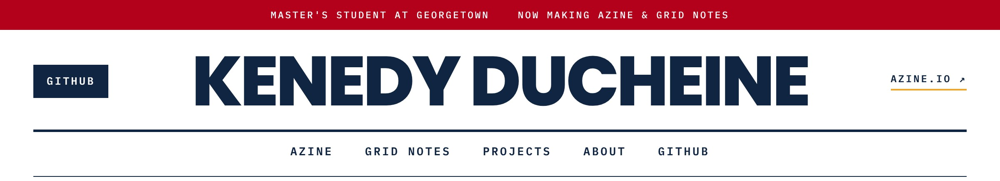
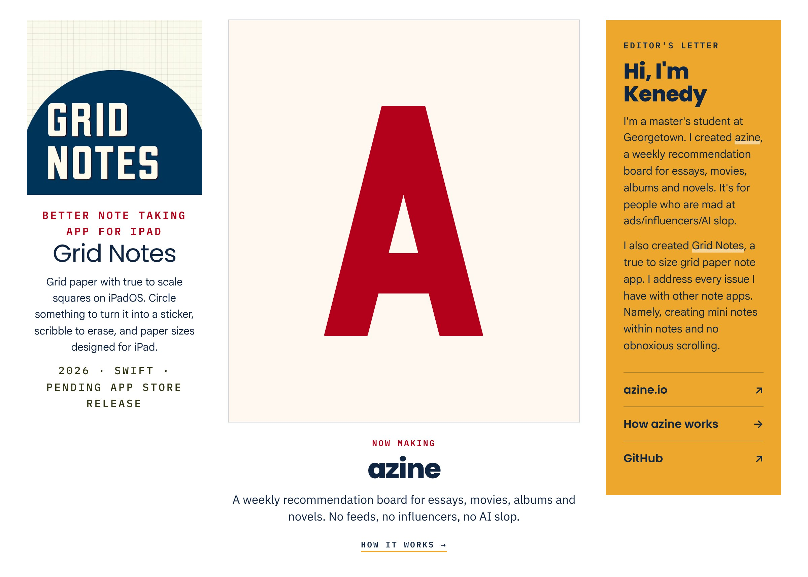
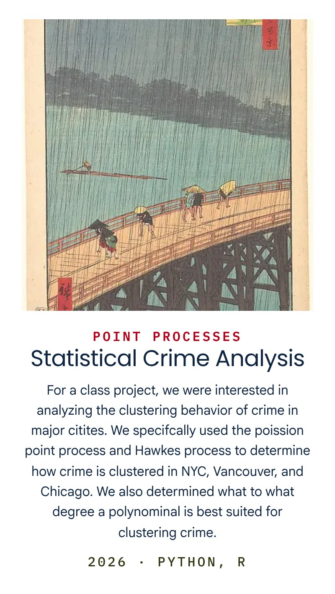
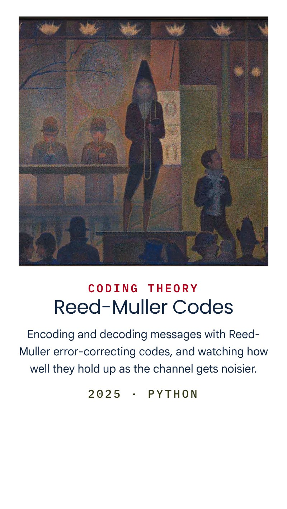
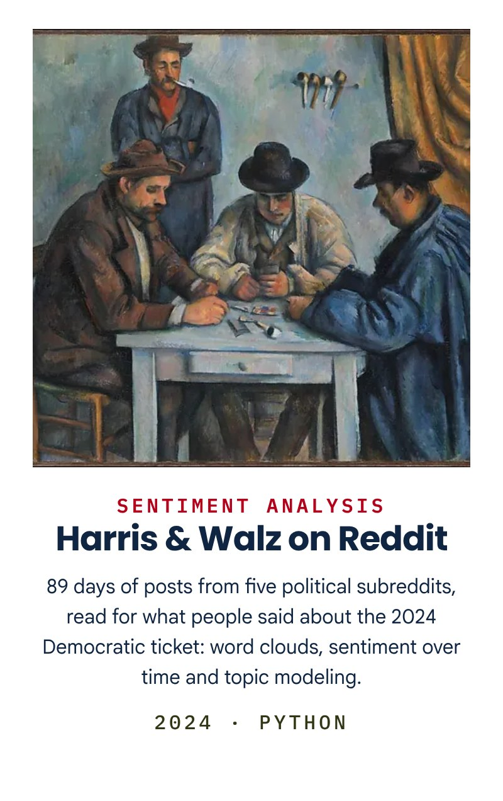
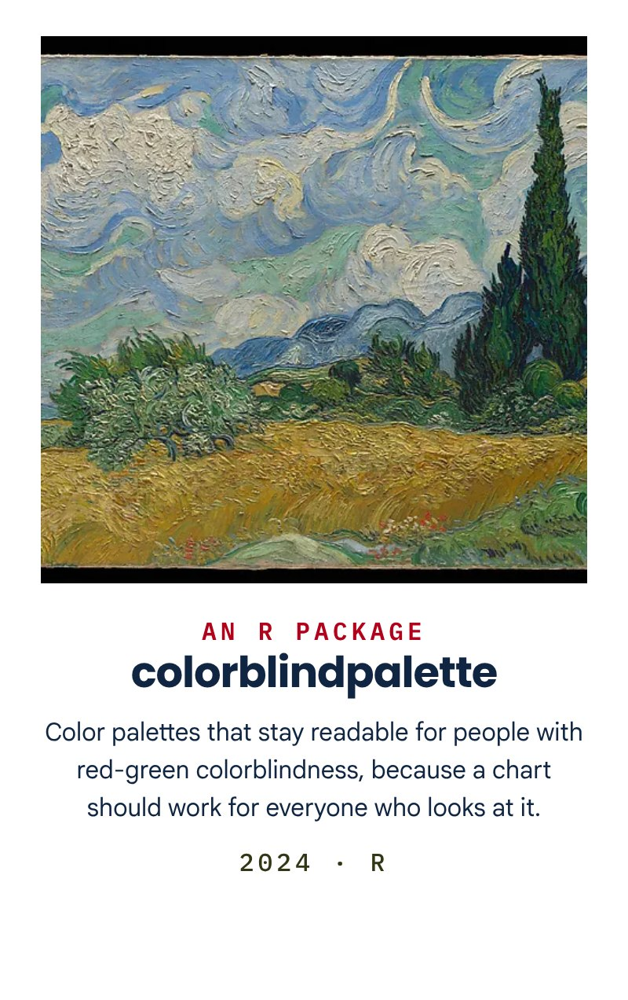
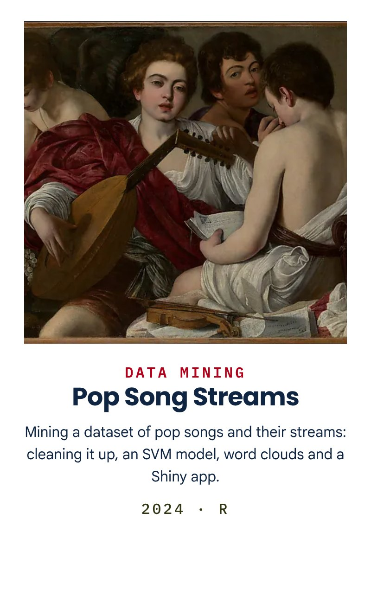
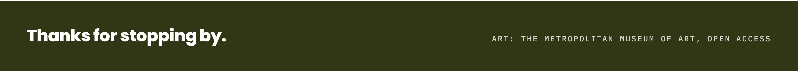

<!-- Profile README: what shows at github.com/kenedyducheine.
     GitHub doesn't allow custom styles here, so each panel is a picture of
     kenedyducheine.github.io (same layout, colors and fonts). The words are
     part of the pictures: to change what shows, change the site, then
     re-make the pictures from it. -->

  <a href="https://kenedyducheine.github.io">kenedyducheine.github.io</a> ·
  <a href="https://kenedyducheine.github.io/azine.html">How azine works</a> ·
  <a href="https://azine.io">azine.io</a>

