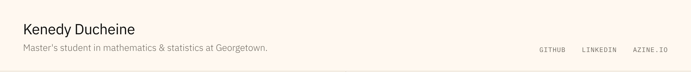
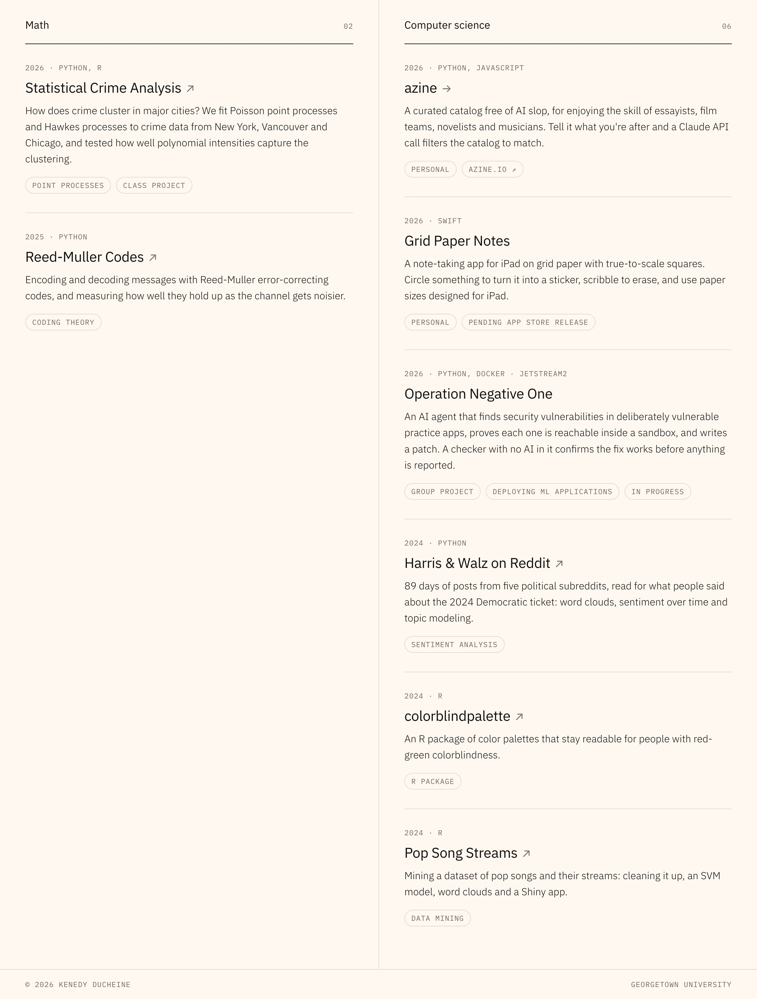

<!-- Profile README: what shows at github.com/kenedyducheine.
     GitHub doesn't allow custom styles here, so the panels are pictures of
     kenedyducheine.github.io (same layout, colors and fonts). The words are
     part of the pictures: to change what shows, change the site, then
     re-make the pictures from it. -->

<!-- plain text, so search engines have words to find (the panels above are pictures) -->

<b>Kenedy Ducheine</b> · Math and statistics master's student at Georgetown University · creator of <a href="https://azine.io">azine</a>, a curated catalog of essays, movies, albums and novels free of AI slop, and Grid Paper Notes, a grid paper notes app for the iPad.

  <a href="https://kenedyducheine.github.io">kenedyducheine.github.io</a> ·
  <a href="https://kenedyducheine.github.io/azine.html">How azine works</a> ·
  <a href="https://azine.io">azine.io</a>

